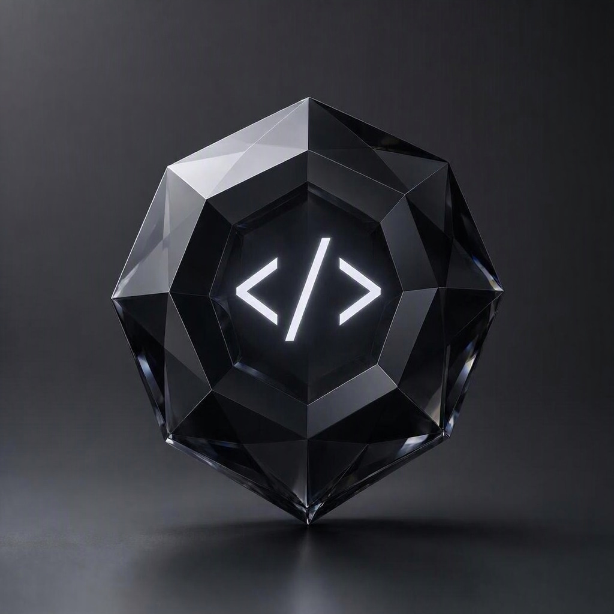

<p align="center">
  
</p>

<p align="center">
  <b>A simple, modern programming language</b><br>
  With static type checking, first-class modules, and a built-in REPL.
</p>

<p align="center">
  <a href="#features">Features</a> •
  <a href="#quick-start">Quick Start</a> •
  <a href="#modules">Modules</a> •
  <a href="#license">License</a>
</p>

---

## Features

- **Simple syntax** — learn in minutes
- **Static type checking** — catch errors before running
- **Optional types** — `set x = 5;` or `set x: int = 5;`
- **First-class modules** — `use math;` and get `math.sqrt`, `math.pi`, ...
- **Smart suggestions** — typos are corrected automatically
- **Built-in REPL** — experiment in the terminal
- **VS Code support** — syntax highlighting, error markers

## Quick Start

Create `hello.onyx`:

```onyx
use math;

say("Hello, Onyx!");

set radius = 5;
set area = math.pi * math.pow(radius, 2);
say("Area:", area);